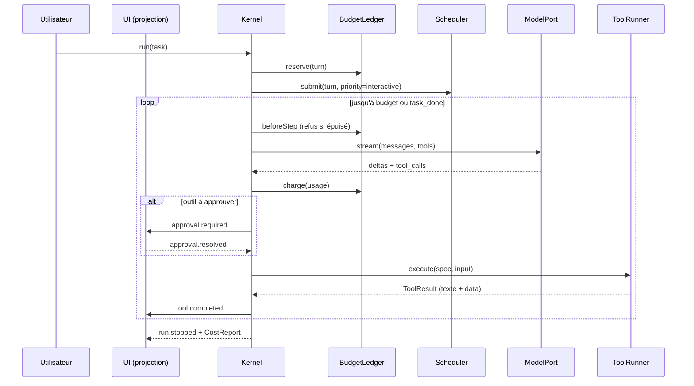

# ANZAR — Audit d'architecture et plan de refonte

> **Date** : 21 novembre 2026 · **Périmètre** : `apps/desktop` (harnais, agents, skills, UI, Rust), `services/api`, CI/CD.
> **Branche observée** : `main` (281 commits, dernier : `6aa630e`).
> **Méthode** : lecture intégrale des modules du harnais, des politiques de sécurité, du proxy de facturation ; analyse du churn des 40 derniers commits ; revue de l'état de l'art (MCP, A2A, AGENTS.md, Agent Skills, sandboxes OS, écosystème chinois).
> **Convention** : les références `fichier:ligne` renvoient à l'état du dépôt au commit `6aa630e` ; elles peuvent glisser de quelques lignes après une édition.
> **Ce document n'est pas un audit de conformité** : c'est une revue d'ingénierie destinée à décider d'une trajectoire.

---

## 0. Résumé exécutif

**Verdict.** ANZAR n'est plus un prototype : c'est un harnais agentique réel, avec des choix que beaucoup d'outils open source n'ont pas encore faits (cache de prompt exploité explicitement, repo map PageRank déterministe, isolation OS des commandes, contenu externe encadré, client MCP 2026-07-28, sessions durables). La dette n'est pas dans les idées : elle est dans **la forme du code autour de ces idées**. Un seul fichier — `runtime/agentRunner.ts`, 1 215 lignes — concentre l'orchestration, l'état d'UI, la comptabilité, la persistance, l'approbation et la construction du prompt. C'est le goulot d'étranglement de tout le reste : tests, budgets, sous-agents, skills, évolutivité.

**Les cinq constats structurants.**

| # | Constat | Conséquence |
|---|---|---|
| 1 | Le noyau est bon, l'adaptateur est un monolithe | Toute évolution du produit touche un fichier de 1 200 lignes sans test d'intégration |
| 2 | Il n'existe **aucun budget** dans le moteur (seulement 40 étapes) | Une automatisation peut brûler le solde sans plafond ; les tickets ont un watchdog, pas le chat ni les automatisations |
| 3 | L'orchestration est ad hoc (3 boucles propriétaires, 3 rôles codés en dur) | Impossible d'ajouter un agent sans toucher au code ; sous-agents non streamés, non budgétés, non isolés |
| 4 | Les skills sont un excellent format **sans modèle d'exécution** | `allowed-tools` est affiché au modèle mais jamais appliqué ; une skill distante est du prompt non signé |
| 5 | La même politique de sécurité existe en 4 exemplaires qui divergent déjà | Faux sentiment de sécurité + maintenance ×4 |

**Le risque le plus grave n'est pas dans le harnais** : c'est le proxy de facturation qui lit `request.json()` **avant** toute réservation, sans plafond de corps (`services/api/routes/chat.py:215`). Un compte à 0 FCFA peut faire tomber l'API (1 Go de RAM, un seul process) de façon répétable. C'est le seul P0 du rapport.

**Ce qu'il faut décider maintenant.** Ne pas réécrire. Extraire : (1) un noyau sans React ni Tauri, (2) un orchestrateur à manifestes, (3) un contrat d'outil structuré. Les jalons 1 à 3 du §10 tiennent en 6 semaines et suppriment 70 % du risque.

---

## 1. État des lieux : ce que les 40 derniers commits ont construit

### 1.1 Cartographie quantitative

| Zone | Volume | Tests | Observation |
|---|---|---|---|
| `apps/desktop/src` (TS/TSX) | **32 666 lignes** | 39 fichiers, 182 cas | Cœur produit |
| dont `services/agent/**` | **7 747 lignes** (≈ 6 300 hors tests) | 47 cas | Un moteur de 293 lignes, un adaptateur de 1 215 |
| `apps/desktop/src-tauri` (Rust) | **2 611 lignes**, 9 modules | 19 tests | **Jamais compilé en CI** |
| `services/api` (Python) | **7 975 lignes** | 77 cas / 12 fichiers | 600 lignes dans `security.py` |
| `apps/admin` | 3 327 lignes | typecheck seul | — |
| `apps/site` | HTML/CSS/JS statique | — | Sans build |

### 1.2 Ce qui est réellement solide — à ne pas casser

1. **L'exploitation du cache DeepSeek est de niveau expert.** Le prompt système est découpé en `systemHead` / `systemRefresh` / `turnContext` (`context/systemPrompt.ts:48-105`), la compaction n'est déclenchée qu'à cache froid ou au-delà du seuil (`agentRunner.ts:547`), le raisonnement des tours précédents est retiré, les images déjà analysées sont remplacées par un marqueur (`agentRunner.ts:552-566`). Le cache DeepSeek coûte ~50× moins cher qu'un cache-miss — cette discipline vaut des points de marge directement.
2. **La repo map.** PageRank sur le graphe d'imports, personnalisé par la tâche (`context/repoRank.ts`, `context/agentContext.ts:109-139`), déterministe donc cache-compatible. C'est le pattern d'Aider, correctement exécuté.
3. **La frontière Rust.** Aucun shell intermédiaire, allowlist de programmes, `env_clear`, `process_group(0)`, job object Windows, racines canoniques persistées en 0600, Seatbelt par défaut (`tool_runner.rs`, `sandbox.rs`, `roots.rs`, `winjob.rs`). C'est au-dessus de la moyenne des outils grand public.
4. **Le modèle de facturation.** Réserver le coût **maximal**, plafonner `max_tokens` à ce que le solde peut payer, débiter le réel même au-delà du solde (dette), libérer la réservation dans tous les cas, `settle()` protégé par `asyncio.shield` (`services/billing.py:6-14,190-203`). Peu de produits africains ont ce niveau de rigueur.
5. **Le contenu externe.** Encadrement par identifiant aléatoire, repérage d'injections, accord obligatoire après lecture avant toute commande (`policy/untrusted.ts`, `toolPolicy.ts:36-83`). Rare, et pertinent.
6. **Les sessions durables.** Historique API complet + journal d'événements JSONL, reprise après crash (`runtime/sessionStore.ts`), `closeDanglingToolCalls` qui répare un historique interrompu (`engine/history.ts:66-77`).

### 1.3 Ce que l'historique récent révèle (churn)

Les 40 derniers commits se concentrent sur `agentRunner.ts` (6), `terminal.ts` (7), `tool_runner.rs` (6), `SECURITY.md` (8), `AGENT_ENGINE.md` (5). **Trois fichiers portent presque toute la complexité récente** : l'adaptateur, le broker de commandes, la documentation de sécurité. La vélocité est réelle, mais elle se dépose sur les mêmes points chauds — signature d'une architecture qui n'a pas encore ses coutures.

Deux régressions de cohérence sont déjà visibles dans l'historique :

- `docs/desktop/AGENT_ENGINE.md:55` affirme « ajouter un rôle d'agent = créer `profiles/<nom>.md` ». Faux : `SUBAGENT_ROLES` est une union de types codée en dur (`profiles/index.ts:62-63`) et les champs `tools` / `model` du frontmatter ne sont **jamais lus** (seul `maxSteps` l'est, `spawn.ts:65`).
- `docs/BLUEPRINT.md:122` annonce des tests Rust exécutés. Ils existent, mais **aucun workflow CI ne les lance** (`ci.yml` n'a que `api` et `desktop`).

---

## 2. Audit du harnais d'exécution

### 2.1 La boucle (`engine/agentSession.ts`, 293 lignes)

La conception est saine : une boucle, des adaptateurs, des dépendances injectées (`stream`, `executeTool`, `verify`), aucun import React ou Tauri. Trois défauts la limitent.

**(a) Les callbacks ne sont pas un protocole.** Vingt-et-un callbacks (`agentSession.ts:39-75`) décrivent des événements de cycle de vie, mais sans type discriminé, sans ordre garanti documenté, sans possibilité de rejeu. Les conséquences : l'UI doit re-dériver l'état, les tests doivent mocker neuf callbacks, et un consommateur ne peut pas observer *ce qui s'est passé* sans réimplémenter le sens des signaux. Comparer à l'event stream d'OpenHands, où le flux d'événements **est** la source de vérité.

**(b) Le budget est un compteur d'étapes.** `maxSteps = 40`, `maxConsecutiveErrors`, et c'est tout. Aucun plafond de tokens, de FCFA, de durée. `maxConsecutiveErrors: 0` est même explicitement désactivé dans le chat principal (`agentRunner.ts:615`), au motif que le mode Auto escalade. Résultat : une boucle d'échecs non détectée peut consommer 40 × (entrée + 16 k sortie) avant de s'arrêter.

**(c) Le moteur n'a aucune mémoire d'intention.** Avant d'exécuter un outil, il n'écrit rien. Si l'application meurt entre `write_file` et l'écriture de session, `closeDanglingToolCalls` déclare l'appel « interrompu » — correct pour la validité de l'historique, faux du point de vue de la réalité du disque. Il manque un journal *write-ahead* : intention → exécution → résultat.

### 2.2 L'adaptateur (`runtime/agentRunner.ts`, 1 215 lignes) — le point de rupture

Ce fichier est simultanément : orchestrateur de session, couche de décision produit, constructeur de prompt, comptable, persistance, hôte MCP, arbitre d'approbation, pilote de vérification, et mutation d'état Zustand. Il importe 30 modules dont **quatre stores** (`useSettingsStore`, `useChatStore`, `useUsageStore`) et `lib/credits` (`agentRunner.ts:36-44`).

Trois symptômes mesurables :

- **Trois constructions de promesse d'approbation différentes** dans la même fonction : l'outil normal (`:813-818`), la vérification (`:716-724`), la ré-approbation réseau (`:889-896`). Un seul `approvalResolver` en slot unique (`:248`) : si un jour deux demandes se chevauchent (sous-agent parallèle, par exemple), la seconde écrase le résolveur de la première et **la première attente ne revient jamais**.
- **Des chemins d'exécution dédoublés** : le sauvetage d'export appelle `executeToolCall` directement (`:1026`), hors politique d'approbation (garde-fou : mode `full` seulement), avec une comptabilité recopiée à la main. La synthèse finale appelle `chatStream` directement (`:1055`), hors moteur. Trois façons de faire un tour de modèle.
- **Des décisions produit dans des closures** : compaction, condensation, escalade Auto, garantie d'export, mode plan, espace ANZAR. Rien de tout cela n'est testable sans monter un store.

C'est exactement ce que la documentation reconnaît (`AGENT_ENGINE.md:138-146`). Le diagnostic est posé ; il manque la couture.

### 2.3 Vérification

`runVerification` détecte lint/typecheck/build/test par `package.json` et exécute séquentiellement, 180 s max par commande, 3 cycles (`verify/agentVerifier.ts`). Quatre défauts :

1. **Pas de ligne de base.** Un projet dont le build est déjà cassé ne peut jamais franchir `task_done` : l'agent corrige, échoue 3 fois, et rend `verify_failed`. Il faut capturer un état de référence **avant la première écriture** et ne garder que les **nouveaux** échecs.
2. **Pas de vérification ciblée.** Un README modifié déclenche build + tests complets (`shouldVerify: filesWritten > 0`, `:704`). Sur un monorepo, 3 cycles × 4 commandes × 180 s ≈ 36 minutes possibles.
3. **Échec silencieux en arrière-plan.** `background` fait refuser toute commande risquée pendant la vérification (`:719`) : une automatisation croit avoir vérifié, rien n'a tourné.
4. **Sortie bornée à 8 000 caractères** (`agentVerifier.ts:46`) : la cause racine disparaît souvent du résumé réinjecté.

### 2.4 Contexte et compaction

- L'estimation de tokens est `chars / 4` (`chatSession.ts:7-11`) et le seuil est **160 000 caractères** (`history.ts:13`) — soit ~40 k tokens, pour un modèle à 1 M. On compacte donc 25 fois trop tôt, en payant des résumés inutiles.
- `buildAgentContext` relit jusqu'à **800 fichiers avec leur contenu** (`agentContext.ts:50`, `MAX_INDEXED_FILES * 2`), **séquentiellement** (`fileSystem.ts:222-243`), dans le renderer, à chaque nouveau message (cache 2 min). Sur un projet moyen, c'est un gel perceptible entre deux étapes.
- `codeIndexer` est heuristique (regex) : pas de tree-sitter, donc pas de navigation symbolique fiable.
- Les images ne sont pas persistées (`sessionStore.ts:35-42`) : une reprise après crash perd le contexte visuel — acceptable, mais à dire dans l'UI.

### 2.5 Tableau des risques du harnais

| Sév. | Risque | Preuve | Impact |
|---|---|---|---|
| **P1** | Aucun budget tokens/FCFA/durée dans le moteur | `agentSession.ts:96,104` | Automatisation non plafonnée (aucun `onProgress`, `automationQueue.ts:30-36`) |
| **P1** | Aucune détection de boucle (même outil + mêmes args) | `agentSession.ts:250-253` | Boucles d'édition coûteuses, seul le compteur d'erreurs aide |
| **P1** | Ligne de base de vérification absente | `agentVerifier.ts`, `agentRunner.ts:704` | Projet déjà cassé ⇒ agent bloqué en `verify_failed` |
| **P2** | Résolveur d'approbation en slot unique | `agentRunner.ts:248,721,814,890` | Attente perdue si deux demandes concurrentes |
| **P2** | Chemins d'exécution dédoublés (sauvetage, synthèse) | `agentRunner.ts:993-1069` | Dérive de politique et de comptabilité |
| **P2** | Pas de journal d'intention avant un outil | `agentSession.ts:220-239` | État disque/historique divergent après crash |
| **P2** | `maxConsecutiveErrors: 0` dans le chat | `agentRunner.ts:615` | Boucle d'erreurs non bornée |
| **P3** | Estimation tokens `chars/4` et seuil 160 k | `history.ts:13`, `chatSession.ts:7` | Compaction prématurée, coût |
| **P3** | Repo map sur le thread UI, 800 fichiers | `agentContext.ts:50` | Jank entre étapes |

---

## 3. Audit des agents, sous-agents et skills

### 3.1 Taxonomie actuelle et ses cinq défauts

Le modèle est : 1 agent principal (prompt unique), 1 outil `explore` (explorateurs read-only), 1 outil `spawn_subagents` (3 rôles), 4 fichiers `profiles/*.md`.

| # | Défaut | Preuve |
|---|---|---|
| 1 | Rôles figés dans une union de types : un nouveau `.md` ne crée pas un rôle | `profiles/index.ts:62-68` |
| 2 | `tools` et `model` du frontmatter ignorés : un sous-agent `pro` demandé tourne en `fast` | `profiles/index.ts:36-39` vs `spawn.ts:61-80` |
| 3 | Rôle deviné par regex française quand l'agent ne le précise pas | `profiles/index.ts:69-73` |
| 4 | `spawn` impose **2 à 3** tâches : impossible de déléguer une seule tâche | `spawn.ts:17,26` |
| 5 | En mode Full, les sous-agents écrivent **séquentiellement** (lent et risqué) ; hors Full, tout est read-only | `spawn.ts:101-110` |

Deux duplications supplémentaires : le registre d'outils des explorateurs est recopié à la main (`explorers.ts:20-25`), donc ajouter un outil read-only demande deux éditions ; et le mode de permission est hérité en bloc, sans notion de capacité restreinte par sous-agent (`subagentPolicy.ts:18-24`).

### 3.2 Ce que la délégation ne fait pas

- **Pas de streaming du texte d'un sous-agent.** L'UI ne voit qu'une ligne « action en cours » (`spawn.ts:72-79`). L'utilisateur ne peut ni juger, ni interrompre sélectivement.
- **Pas de budget dérivé.** Le parent a 40 étapes et N FCFA ; chaque enfant a son propre `maxSteps` et consomme le solde global sans plafond par enfant. Un `spawn` de 3 agents Full peut dépenser plus que le parent.
- **Pas d'isolation d'écriture.** Seuls les tickets ont une worktree (`superagent/ticketGit.ts`). Trois sous-agents qui écrivent dans le même arbre, même séquentiellement, ne profitent d'aucune transaction.
- **Pas de sortie structurée.** Le rapport est une concaténation de chaînes tronquées à 500 caractères (`spawn.ts:112-118`).
- **Pas de vérification.** `autoVerify: false` et `gitCheckpoint: false` sont posés explicitement (`spawn.ts:66-67`) : la responsabilité est déléguée au prompt (« vérifie maintenant »), pas au code.

### 3.3 Skills : bon format, modèle d'exécution absent

Le format est conforme à agentskills.io (`format.ts`), les emplacements sont les bons (`.anzar`, `.agents`, `.dsh`, `.claude`, `~/.agents/skills`), la découverte progressive existe (liste dans le prompt, corps via `load_skill`, fichiers joints à la demande). Quatre manques :

1. **`allowed-tools` n'est pas appliqué.** Le parseur le lit (`format.ts:64-85`), l'affiche au modèle en texte (`skills/index.ts:203`) — mais aucun code ne restreint les outils pendant qu'une skill est active. C'est une promesse du format laissée vide, et c'est exactement ce que Claude Code applique.
2. **Aucune validation.** Pas de lint de `SKILL.md` (nom, description ≤ 1024, corps < 500 lignes, doublons). Une skill mal formée casse silencieusement.
3. **Aucune provenance.** Les skills distantes arrivent en Markdown par `GET /api/agent/skills` (`skills/remote.ts`), mises en cache dans `localStorage` avec un ETag. Si l'API est compromise, elle injecte des **instructions** dans le prompt système. Aucune signature, aucun checksum, aucun bac à sable pour un éventuel script.
4. **Aucun budget de contexte.** Le corps est tronqué à 20 k caractères et le résultat `load_skill` est **exclu de la compaction** (`history.ts:16,51`) : une grosse skill reste dans l'historique à chaque tour, payée à chaque tour.

### 3.4 Comparaison aux standards (novembre 2026)

| Critère | ANZAR | Référence marché | Écart |
|---|---|---|---|
| **Sous-agents déclaratifs** | `profiles/*.md` partiels | Claude Code : frontmatter `tools`/`model`/`permissionMode`/`maxTurns`/`isolation: worktree`, profondeur 3, 20 concurrents, résumé seul remonté ([docs](https://code.claude.com/docs/en/sub-agents.md)) | Champs non appliqués, pas d'isolation |
| **Orchestrateur sans outils fichiers** | Agent principal a tous les outils | Roo Code « boomerang » : l'orchestrateur n'a **pas** d'outils fichiers, `new_task`/`attempt_completion` seulement — défense anti-context-poisoning ([docs](https://github.com/RooCodeInc/Roo-Code-Docs/blob/main/docs/features/boomerang-tasks.mdx)) | Concept à reprendre |
| **Permissions déclaratives** | 4 modes + 4 validateurs | OpenCode : `action`/`resource`/`effect: allow\|ask\|deny`, dernière règle gagnante ([docs](https://opencode.ai/docs/agents/)) | À adopter tel quel |
| **Sandbox vs approbation** | Un seul bouton « isoler » | Codex : *sandbox mode* et *approval policy* sont **deux réglages indépendants**, réseau coupé par défaut, proxy avec allowlist ([docs](https://learn.chatgpt.com/docs/agent-approvals-security)) | Séparation à faire |
| **Skills** | Format OK, `allowed-tools` inerte | Agent Skills : description ≤ 1024 char porte le déclenchement, 3 niveaux de divulgation, `skills-ref` pour valider ([spec](https://agentskills.io/specification)) | Enforcer + valider |
| **Protocole d'outils** | 21 outils, sorties texte | MCP 2026-07-28 : noyau stateless, MRTT, listes cacheables, `structuredContent` | Client à jour, mais capacités modernes vides (`client.ts:165-172`) et `structuredContent` ignoré |
| **Durabilité** | Sessions + reprise | LangGraph : checkpoints par thread, `interrupt`, time-travel ([docs](https://docs.langchain.com/oss/python/langgraph/persistence)) | Pas de reprise *intra-outil* |
| **Éval** | Aucune | Terminal-Bench note agent+modèle avec coût/tokens ([tbench.ai](https://www.tbench.ai/)) | À créer |

Deux points où ANZAR est **en avance** : le client MCP `2026-07-28` (noyau stateless, `server/discover`, repli legacy — `mcp/client.ts:1-20`) et l'exploitation du cache de prompt. Il faut le dire et ne pas les casser.

---

## 4. Audit structurel : couches, couplages, dette

### 4.1 Les frontières sont inversées

Frontière attendue : `types ← lib(host) ← services(domaine) ← stores ← hooks ← composants`.

Frontière réelle :

- **Domaine → présentation** : `services/agent/**` importe quatre stores Zustand ; `tools/fsTools.ts:11-14` lit `useSettingsStore` pour savoir si les diagnostics sont activés. Le domaine n'est pas exécutable sans UI.
- **Présentation → Tauri** : 3 composants/pages appellent `invoke` directement (`ChatInput.tsx:21`, `TitleBar.tsx:3`, `SettingsPage.tsx:140`).
- **Bus inter-composants par `window` CustomEvents** : 5 événements exportés par des feuilles (`GitPanel.tsx:27`, `PlanView.tsx:14-15`, `fileChanges.ts:154-155`) — dépendance inversée entre composants frères.
- **`types/index.ts` (641 lignes)** : 11 domaines, 44 exports, plusieurs sans consommateur. Une seule adresse pour tout importer.

### 4.2 Quatre politiques de commandes qui divergent déjà

| Emplacement | Rôle | Divergence constatée |
|---|---|---|
| `src-tauri/src/tool_runner.rs:17-20,63-111` | Application réelle | `pnpm`, `yarn`, `deno`, `tsx` **absents** de l'allowlist |
| `policy/commandPolicy.ts:8-36,91-106` | Pré-contrôle + tokenisation | Gère `pnpm`/`yarn`… que Rust refusera |
| `policy/commandGuard.ts:71-84` | Risque « script npm » | Liste de motifs propres, non alignée |
| `src-tauri/src/sandbox.rs:120-125`, `roots.rs:18`, `capabilities/migrated.json` | Dossiers/secrets sensibles | `.netrc`, `*.pem`, `.gnupg` absents de certaines listes |

Ce n'est pas de la défense en profondeur : c'est de la **défense en largeur avec des trous**. La bonne réponse n'est pas de synchroniser à la main, c'est de générer : une seule spec `policy/commands.json`, consommée par Rust (application) et par TS (messages d'erreur), avec un test de parité en CI.

### 4.3 Autres dettes mesurables

| Zone | Constat | Preuve |
|---|---|---|
| État | `permissionMode` vit dans `localStorage`, lu/écrit par **deux** composants, avec des défauts **opposés** : `'full'` dans les Réglages, `'auto'` dans le workspace | `SettingsPage.tsx:248-257`, `WorkspaceView.tsx:57-66` |
| État | `getSortedConversations` trie le tableau d'état **en place** malgré un commentaire affirmant une copie | `chatStore.ts:112-115` |
| Rust | `tool_wait` est une commande **synchrone** avec attente Condvar jusqu'à 1 h — sur Tauri 2 une commande non-`async` s'exécute sur le thread principal | `tool_runner.rs:253-268` |
| Rust | `vault_key_get` renvoie la clé Stronghold au renderer | `main.rs:157-173` |
| Capabilities | `opener:allow-open-path` sur `$HOME/**` | `capabilities/migrated.json:78-131` |
| CI | Aucun `cargo build`/`cargo test`/`clippy` ; `release.yml` ne compile qu'au tag | `ci.yml` |
| Tests | Vitest ne ramasse que `src/**/*.test.ts` — aucun `.test.tsx` | `vitest.config.ts:17` |
| Bundle | Entrée ~578 Ko (198 Ko gz) au-dessus du seuil de 500 Ko | `vite.config.ts:58-63` |
| Config morte | `offlineMode`, `bandwidthSaver`, `commandExecutionMode`, `deviceVaultKey`, `codeDiagnostics` quasi inutilisés ; `AIProvider` multi-fournisseur alors que le produit est DeepSeek-only | `settingsStore.ts`, `types/index.ts`, `ai/ai.ts` |
| API | Pas de couche service/dépôt (sauf billing/payments), pas d'Alembic, argent en `Float`, `credits.user_email` non `UNIQUE`, variables MFA admin jamais transmises par compose | `db/base.py:93-158`, `db/models.py:72-89`, `deploy/docker-compose.yml:39-62` |

**Le P0 (API)** : `routes/chat.py:215` lit le corps entier avant la réservation ; `main.py:112-143` n'a pas de plafond. Un compte sans crédit peut envoyer 2 000 messages de 200 Ko et faire tomber l'API (limitée à 1 Go). Correctif : middleware `Content-Length` + lecture bornée, **avant** `request.json()`.

---

## 5. Architecture cible

### 5.1 Six principes

1. **Le noyau ignore React, Tauri, Zustand et `window`.** Il ne connaît que des *ports*. C'est la seule façon de tester le produit sans monter une app.
2. **L'événement est la vérité.** Une session produit un flux d'événements typés ; l'UI, le journal, la comptabilité et la reprise sont des projections.
3. **Un budget est un objet de première classe**, pas un compteur d'étapes.
4. **Une capacité, pas un nom.** L'agent demande une *capacité* (`fs.write`, `shell.exec`) ; l'orchestrateur décide si le manifeste de l'agent la contient.
5. **Une politique, une source.** Générée, testée en parité, appliquée au plus près de l'effet de bord.
6. **Rien d'irréversible sans trace.** Intention écrite avant exécution, résultat après.

### 5.2 Arborescence cible

```text
apps/desktop/src/
├── core/                        # zéro import React/Tauri/Zustand
│   ├── kernel/
│   │   ├── runAgent.ts          # machine à états (remplace agentSession)
│   │   ├── events.ts            # AgentEvent (union discriminée)
│   │   ├── budget.ts            # BudgetLedger, dépassements, seuils
│   │   └── loopGuard.ts         # détection de répétition / non-progrès
│   ├── protocol/
│   │   ├── messages.ts          # APIMessage, ToolCall, ToolResult structuré
│   │   ├── errors.ts            # taxonomie (retryable / fatal / utilisateur)
│   │   └── manifest.ts          # schéma AgentManifest + validateurs
│   ├── agents/
│   │   ├── registry.ts          # découverte, validation, résolution
│   │   └── policies/            # permissions, capacités, subagentPolicy
│   ├── tools/
│   │   ├── contracts.ts         # ToolSpec (schémas, effets, timeout, idempotence)
│   │   ├── registry.ts          # une entrée = un outil, exécuteurs purs
│   │   └── impl/                # fs, search, shell, web, media, meta
│   ├── context/
│   │   ├── prompt.ts            # assemblage (head/refresh/turn)
│   │   ├── compact.ts           # compaction + condensation
│   │   └── repoMap.ts           # index incrémental (interface)
│   ├── skills/
│   │   ├── parse.ts, validate.ts, index.ts
│   │   └── grant.ts             # application de allowed-tools
│   ├── verify/
│   │   ├── baseline.ts          # état de référence avant écriture
│   │   ├── select.ts            # vérification ciblée
│   │   └── runner.ts
│   └── orchestration/
│       ├── scheduler.ts         # admission, priorité, préemption
│       ├── workspace.ts         # worktrees, verrous de fichiers
│       └── journal.ts           # write-ahead, reprise
├── ports/                       # interfaces seules
│   ├── model.ts  fs.ts  shell.ts  approval.ts  secureStore.ts
│   ├── mcp.ts    clock.ts  telemetry.ts  notification.ts
├── adapters/
│   ├── tauri/   (invoke, fs, keychain, updater, dialog)
│   ├── http/    (proxy ANZAR, SSE, web tools)
│   ├── mcp/     (client + transports)
│   └── node/    (runtime, installateurs)
├── app/                         # cas d'usage, sans JSX
│   ├── chat/    (session, turn, approvals, accounting)
│   ├── tickets/
│   └── automations/
├── ui/
│   ├── components/  pages/  hooks/
│   └── state/       # stores = projection du core
└── shared/          # types transverses minimaux, i18n, format
```

Côté Rust :

```text
apps/desktop/src-tauri/src/
├── main.rs              # bootstrap uniquement
├── commands/            # un module par domaine IPC
│   ├── fs.rs  shell.rs  roots.rs  mcp.rs  secrets.rs  runtime.rs
├── sandbox/             # seatbelt.rs, winjob.rs, (mxc.rs / restricted_token.rs)
├── policy/              # commands.json inclus au build (include_str!)
└── store/               # sessions, mcp.json, roots.json
```

### 5.3 Règles de dépendance, et comment les faire respecter

| Règle | Vérification automatique |
|---|---|
| `core/**` n'importe ni `ui/**`, ni `app/**`, ni `adapters/**`, ni `@tauri-apps/*`, ni `zustand` | `dependency-cruiser` en CI, plus un test qui résout le graphe |
| `adapters/**` n'importe que `ports/**` et `shared/**` | idem |
| `ui/**` n'importe jamais `@tauri-apps/api` (sauf `adapters/tauri`) | règle ESLint `no-restricted-imports` |
| Un seul store par domaine, jamais de store → store | règle custom |
| Toute politique de sécurité est générée depuis `policy/commands.json` | test de parité TS/Rust |

Ces règles coûtent une journée et suppriment la classe de dette la plus coûteuse à long terme.

### 5.4 Le noyau : machine à états + événements

```ts
// core/protocol/errors.ts
export type AgentError =
  | { kind: 'provider'; retryable: boolean; message: string }
  | { kind: 'budget_exceeded'; limitedBy: 'steps' | 'tokens' | 'fcfa' | 'time' }
  | { kind: 'tool_failed'; tool: string; message: string }
  | { kind: 'approval_denied'; tool: string }
  | { kind: 'aborted' };

// core/kernel/events.ts
export type AgentEvent =
  | { t: 'run.started'; runId: string; agent: string; budget: BudgetView }
  | { t: 'step.started'; step: number }
  | { t: 'model.delta'; text?: string; reasoning?: string }
  | { t: 'model.completed'; text: string; toolCalls: ToolCall[]; usage: Usage }
  | { t: 'tool.requested'; callId: string; tool: string; args: unknown; intent: string }
  | { t: 'approval.required'; callId: string; request: ApprovalRequest }
  | { t: 'approval.resolved'; callId: string; allowed: boolean }
  | { t: 'tool.completed'; callId: string; result: ToolResult }
  | { t: 'verify.started'; attempt: number }
  | { t: 'verify.completed'; passed: boolean; report: VerifyReport }
  | { t: 'budget.warning'; usedPct: number; limitedBy: string }
  | { t: 'run.stopped'; reason: StopReason; summary: string; cost: CostReport };
```

Une seule fonction consomme ces événements : `projectEvents(state, event)` (pure). L'UI est une projection ; le journal est une projection ; la comptabilité est une projection. Le rejeu d'une session devient un test unitaire.

---

## 6. DA — Dossier d'architecture de l'orchestrateur

C'est la pièce qui manque le plus aujourd'hui : trois boucles propriétaires (chat, ticket, automatisation) qui ne partagent que l'adaptateur, et une délégation figée à trois rôles.

### 6.1 Le manifeste d'agent

```yaml
# apps/desktop/src/core/agents/catalog/explorer.agent.md
---
name: explorer
kind: subagent                    # primary | subagent | explorer
description: Répond à UNE question sur le projet, en lecture seule.
model: { mode: fast, reasoning: low }
budget:  { steps: 12, tokensIn: 120000, fcfa: 25, wallMs: 180000 }
tools:   [read_file, list_dir, search_files, get_diagnostics]
deny:    [fs.write, shell.exec, network]
skills:  [repo-navigation]
concurrency: { scope: project, maxParallel: 4 }
output:  { format: summary, maxChars: 3000 }
---
Corps du prompt…
```

Le schéma JSON est validé **au build** (CI) et **à l'exécution** (agents fournis par l'utilisateur). Un manifeste invalide ne démarre jamais. Le registre expose `list(kind)`, `get(name)`, `resolve(capability)`.

**Ce que cela corrige mécaniquement** : rôles extensibles sans code, `tools`/`model` réellement appliqués, budgets par agent, profondeur et concurrence déclarées, sortie structurée.

### 6.2 Le scheduler

```ts
export interface Scheduler {
  submit(task: AgentTask): Promise<RunHandle>;
  cancel(runId: string): void;
  stats(): { running: number; queued: number; budgetUsedFcfa: number };
}

export interface AgentTask {
  id: string;                  // idempotence : rejouer le même id ne relance pas
  agent: string;               // clé du registre
  parent?: { runId: string; callId: string };
  input: { task: string; context?: string };
  workspace: WorkspaceRef;     // projet, worktree, verrous
  budget: BudgetSpec;          // dérivé du parent si absent
  priority: 'interactive' | 'plan' | 'ticket' | 'automation';
  approval: ApprovalChannel;   // où poser les demandes (UI pièce jointe, refus auto…)
}
```

Responsabilités, dans cet ordre :

1. **Admission** : concurrence globale (le serveur ANZAR n'accepte que 4 requêtes IA par compte — `billing.py:79-81` — donc le scheduler doit être le seul à ouvrir des flux), verrou par projet, verrou par fichier pour les écrivains.
2. **Budget dérivé** : le parent réserve une enveloppe à chaque enfant (`BudgetLedger.split()`). Un enfant ne peut pas dépasser son enveloppe ; le reliquat retourne au parent. C'est ce qui rend un `spawn` sûr.
3. **Priorité et préemption** : un tour interactif peut suspendre un ticket (AbortSignal coopératif, checkpoint écrit). Aujourd'hui un ticket monopolisé bloque tout (`ticketQueue.ts`, un seul ticket à la fois).
4. **Isolation** : tout écrivain obtient une worktree (`git worktree add`) ou, à défaut, un verrou exclusif sur les chemins qu'il déclare. Fin de l'alternative absurde « Full = séquentiel ».
5. **Durabilité** : chaque transition écrit une ligne JSONL (`journal.ts`) avant d'agir. Reprise = rejouer les événements `tool.requested` sans `tool.completed`.

### 6.3 Le budget

```ts
export interface BudgetSpec {
  steps: number;
  tokensIn?: number;
  tokensOut?: number;
  fcfa: number;
  wallMs: number;
}

export interface BudgetLedger {
  readonly spec: BudgetSpec;
  charge(delta: Partial<BudgetSpec>): void;
  remaining(): BudgetSpec;
  reserve(share: number): BudgetLedger;   // enfant
  exhausted(): keyof BudgetSpec | null;
  onWarning(cb: (pct: number) => void): void;   // 60 %, 85 %
}
```

Trois règles :

- **Le dépassement est coopératif** : on ne tue pas un flux en cours, on refuse le pas suivant (`beforeStep`), et on laisse le modèle conclure en texte (déjà implémenté, `agentRunner.ts:1046-1069`).
- **Le coût est chargé au plus tôt** : à la fin de chaque étape de modèle, pas à la fin de la session.
- **L'UI l'affiche** : un compteur « 12,40 / 50 FCFA » dans la barre de session. Aujourd'hui l'utilisateur découvre le coût après.

### 6.4 Le contrat d'outil

```ts
export interface ToolSpec<I = unknown, O = unknown> {
  name: string;
  capability: 'fs.read' | 'fs.write' | 'shell.exec' | 'network' | 'browser' | 'media';
  description: string;
  input: JSONSchema;
  output?: JSONSchema;                 // structuredContent, pas seulement du texte
  effects: 'none' | 'fs' | 'process' | 'network';
  idempotent: boolean;
  timeoutMs: number;
  maxOutputChars: number;
  approval: 'never' | 'policy' | 'always';
  execute(input: I, ctx: ToolContext): Promise<ToolResult<O>>;
}

export interface ToolResult<O> {
  text: string;          // ce que lit le modèle
  data?: O;              // ce que lit l'UI (fini le parsing de chaînes)
  artifacts?: Artifact[];
  isError?: boolean;
  costFcfa?: number;
}
```

Bénéfices immédiats : l'UI n'analyse plus `exit_code: 0 (124ms)` pour afficher un badge ; un outil MCP peut remonter `structuredContent` ; le timeout devient une propriété de l'outil, pas une constante globale ; et l'approbation cesse d'être un `if` dans un adaptateur.

### 6.5 Le protocole de délégation

Remplacer `spawn_subagents` par deux primitives :

- `delegate({ agent, task, files?, budgetShare? })` → **un** sous-agent, avec manifeste, budget et worktree.
- `delegate_many({ tasks[] })` → même chose en parallèle, avec détection de chevauchement de fichiers **avant** lancement (refus si deux écrivains déclarent la même cible).

Chaque délégation renvoie un `SubagentReport` structuré : `{ stopReason, summary, filesChanged, verify?, costFcfa, steps }`. Le parent reçoit un tableau, pas une concaténation de chaînes. Et l'UI peut afficher un sous-fil dépliable (streaming du texte de l'enfant via le même flux d'événements, préfixé par `runId`).

### 6.6 Séquence d'un tour (cible)



---

## 7. Skills v2

| Axe | Aujourd'hui | Cible |
|---|---|---|
| Découverte | walk disque à chaque message (`skills/index.ts:123-144`) | index en mémoire invalidé par watcher + hash |
| Divulgation | liste + corps 20 k + fichiers | 3 niveaux explicites, budget de tokens par niveau |
| Outils | `allowed-tools` affiché | **appliqué** : pendant qu'une skill est active, la liste d'outils est restreinte à son grant (+ outils de base) |
| Validation | aucune | `validate.ts` au chargement + en CI : nom, description, longueur, doublons, liens de fichiers |
| Provenance | ETag | SHA-256 + éditeur, vérifié à la réception ; skill distante refusée si le hash ne correspond pas au manifeste du serveur |
| Scripts | interdits « par prompt » | exécutables seulement via `ToolRunner` en sandbox, avec approbation explicite affichant la commande |
| Contexte | corps exclu de la compaction | corps compactable ; seuls les **titres** sont conservés dans le résumé |

Le point 3 est le plus rentable : il transforme une skill d'un texte décoratif en une **unité de capacité**.

---

## 8. Vérification v2

1. **Baseline obligatoire.** Avant la première écriture, exécuter la vérification détectée et stocker `{ ok, failures: FailureId[] }`. Une erreur préexistante n'est pas imputable à l'agent.
2. **Diff de vérification.** Au `task_done`, ne compter que les échecs absents de la baseline. Si `newFailures.length === 0` → accepté, même si le build était déjà rouge.
3. **Ciblage.** `changed files` → commandes les plus proches (`tsc --noEmit -p <sous-projet>`, `vitest <files>`, `pytest <nodeids>`), repli sur la commande complète si le ciblage échoue.
4. **Parallélisme.** lint et typecheck en parallèle ; build puis tests séquentiels. Budget global de vérification (ex. 6 min), pas par commande.
5. **Traçabilité en arrière-plan.** Quand une approbation est impossible, écrire `verify.skipped(reason)` et le remonter dans le rapport du ticket — plus de faux « vérifié ».

---

## 9. Veille critique et inspirations

### 9.1 Ce qu'il faut copier

| Source | Pattern | Pourquoi pour ANZAR |
|---|---|---|
| **Aider** | Repo map tree-sitter + rang de graphe, budgétée ([doc](https://aider.chat/docs/repomap.html)) ; lint/tests sur code de sortie, l'échec *est* le signal ([doc](https://aider.chat/docs/usage/lint-test.html)) | ANZAR a le PageRank mais pas tree-sitter ; la vérification « exit code » est déjà là, à cibler |
| **Codex CLI** | Sandbox *et* approbation = deux réglages indépendants ; proxy réseau avec allowlist ([doc](https://learn.chatgpt.com/docs/agent-approvals-security)) | ANZAR n'a qu'un « isoler les commandes » ; la vraie barrière portative est le proxy réseau |
| **Claude Code** | Sous-agents : contexte propre, `tools`/`model`/`maxTurns` en frontmatter, 3 niveaux, résumé seul ([doc](https://code.claude.com/docs/en/sub-agents.md)) | Directement transposable au manifeste du §6.1 |
| **Roo Code** | Orchestrateur **sans** outils fichiers : `new_task` / `attempt_completion` ([doc](https://github.com/RooCodeInc/Roo-Code-Docs/blob/main/docs/features/boomerang-tasks.mdx)) | Défense anti-context-poisoning quasi gratuite |
| **OpenCode** | Permissions `action`/`resource`/`effect`, dernière règle gagnante ([doc](https://opencode.ai/docs/agents/)) | Remplace les 4 validateurs du §4.2 |
| **OpenHands** | Event stream comme source de vérité ([arXiv](https://arxiv.org/abs/2407.16741)) | C'est le §5.4 |
| **MCP** | Révision `2026-07-28` : stateless, MRTT, listes cacheables, Tasks en extension ([blog](https://blog.modelcontextprotocol.io/posts/2026-07-28/)) | ANZAR a déjà le client ; il manque MRTT et `structuredContent` |
| **Agent Skills** | `SKILL.md`, description ≤ 1024, divulgation en 3 niveaux, `skills-ref` ([spec](https://agentskills.io/specification)) | ANZAR a le format ; il manque l'application |

### 9.2 Ce qu'il ne faut pas copier

- **A2A** : inutile pour un desktop mono-utilisateur ; à garder pour une future offre « agents hébergés ».
- **Event stream sans persistance** : un desktop qui perd la trace d'un patch en cours est inacceptable.
- **Sandbox OS comme unique frontière** : sur Windows natif il n'existe pas (Claude Code exige WSL2). La barrière portable est le proxy réseau.
- **SWE-bench Verified** comme objectif : saturé et contaminé. Utiliser Terminal-Bench (coût/tokens par tâche) et vos propres tâches.

### 9.3 Écosystème chinois

| Acteur | État | Ce qu'on en retient |
|---|---|---|
| **DeepSeek V4** | `deepseek-flash` (V4.1) / `deepseek-v4-pro`, 1 M de contexte, cache-hit à 0,003 $/M contre 0,15 $/M ([pricing](https://api-docs.deepseek.com/quick_start/pricing), [cache](https://api-docs.deepseek.com/guides/kv_cache)) | Le cache par préfixe persistant valide la stratégie ANZAR ; l'architecture doit rester **append-only en tête** |
| **Qwen3-Coder-Next** | Poids ouverts Apache-2.0, 262 k tokens ([HF](https://huggingface.co/Qwen/Qwen3-Coder-Next)) | Option de repli/offline à évaluer, pas avant l'éval §11 |
| **Kimi K2.5** | MIT modifié, orchestration « swarm » revendiquée ([HF](https://huggingface.co/moonshotai/Kimi-K2.5)) | Les chiffres (100 sous-agents) sont du marketing : ne pas architecturer dessus |
| **GLM-5 / 5.2** | 744B-A40B, contexte 1 M, Terminal-Bench 2.1 revendiqué ([repo](https://github.com/zai-org/GLM-5)) | À comparer sur *votre* banc avant tout basculement |
| **AgentScope 2.0** | Apache-2.0 : Toolkit (Python + MCP + skills), compaction + offload, HITL, backends sandbox multiples ([repo](https://github.com/agentscope-ai/agentscope)) | La meilleure référence d'**architecture** pour le §6 ; pas une dépendance |
| **Trae SOLO** | Fermé, desktop + cloud ([article](https://m.leiphone.com/category/industrynews/HlSXWFj00fGo38wZ.html)) | À observer : même cible produit (marché émergent) |
| **Qoder CN** (ex-Lingma, renommé 05/2026) | Fermé, Agent Mode + MCP ([Alibaba Cloud](https://www.alibabacloud.com/help/zh/lingma/what-is-qoder-cn)) | Confirme la convergence UI (mode agent + connecteurs) |
| **Dify / Coze / FastGPT** | Plateformes de workflow, pas des harnais de code | Hors sujet pour le cœur, utiles pour des automatisations no-code en périphérie |

**Incertitudes assumées** : qualité réelle du function calling multi-tours de DeepSeek V4, licence exacte des poids GLM-5.3, chiffres de swarm Kimi — non vérifiés indépendamment. À trancher par le banc du §11, pas par la communication.

---

## 10. Plan d'action

### Jalon 0 — Semaine 1 : arrêter les fuites (5 jours)

| Action | Fichier | Critère d'acceptation |
|---|---|---|
| Plafond de corps HTTP avant `request.json()` | `main.py:112`, `routes/chat.py:215` | requête > 2 Mo → 413 ; test pytest |
| Réservations persistées en base | `services/billing.py:39` | deux workers ne peuvent plus double-réserver ; test de concurrence |
| `permissionMode` dans le settings store | `SettingsPage.tsx:248`, `WorkspaceView.tsx:57` | une seule source, un seul défaut (`auto`) |
| `#[tauri::command(async)]` sur `tool_wait`/`tool_kill` | `tool_runner.rs:253,270` | UI fluide pendant une commande |
| Job CI Rust (`cargo test`, `clippy -D warnings`) | `ci.yml` | 19 tests Rust visibles sur chaque PR |
| Retirer `vault_key_get` de l'IPC, restreindre `opener` | `main.rs:157`, `migrated.json:78` | la clé ne franchit plus l'IPC ; pas de `open-path` sur `$HOME/**` |

### Jalon 1 — Semaines 2-4 : le noyau respire

1. **Extraire `agentRunner` en 4 modules** (`session`, `turn`, `toolHost`, `accounting`) — **sans changer le comportement**, avec un test d'intégration à modèle enregistré (SSE rejoué).
2. **Budget de première classe** : `BudgetSpec` dans le moteur, `onBudgetWarning`, plafonds par défaut (chat, ticket, automatisation). Les automatisations gagnent les champs `budgetFCFA`/`maxMinutes` qui leur manquent (`automationStore.ts`).
3. **Détection de boucle** : empreinte `(outil, args normalisés)` sur 5 derniers appels → refus et message actionnable.
4. **Baseline de vérification** + diff d'échecs + ciblage.
5. **Une seule politique de commandes** : `policy/commands.json` généré → Rust l'inclut (`include_str!`), TS la lit pour les messages ; test de parité.
6. **Supprimer les chemins dédoublés** (sauvetage d'export, synthèse) : les exprimer comme *modes* du moteur.

*Critère de sortie* : `agentRunner.ts` < 400 lignes ; un test d'intégration couvre un tour complet avec outil, refus, vérification et reprise.

### Jalon 2 — Mois 2-3 : l'orchestrateur

1. **`AgentManifest` + registre** (schéma, validation CI), migration des 4 profils, `delegate`/`delegate_many`.
2. **Scheduler** : admission, 4 flux max côté serveur, verrous projet/fichier, priorité, préemption coopérative.
3. **Budget dérivé** : enveloppe par sous-agent, reliquat restitué.
4. **Worktree par écrivain** (plus seulement par ticket) + verrous déclarés.
5. **Événements + journal write-ahead** : reprise intra-outil, rejeu de session en test.
6. **Skills v2** : `allowed-tools` appliqué, validateur CI, hash des skills distantes.
7. **Streaming des sous-agents** dans l'UI (sous-fil dépliable).

*Critère de sortie* : ajouter un agent = un fichier `.md` + une entrée de registre ; un ticket peut tourner pendant qu'un chat interactif se déroule sans le bloquer.

### Jalon 3 — Trimestre : la profondeur

1. **Repo map tree-sitter incrémentale**, calculée hors thread UI (idéalement en Rust), outils symboliques (`find_symbol`, `references`).
2. **Isolation Windows** : jeton restreint + ACL, ou MXC sur Windows 11 récent, avec repli explicite et message clair.
3. **Proxy réseau avec allowlist de domaines** (la vraie barrière portative), réglage distinct de l'isolation.
4. **ACI v2** : sorties structurées, édition par patch, prévisualisation de diff avant application.
5. **Skills marketplace** : provenance, éval par skill, versionnage.
6. **MCP MRTT + Tasks** pour les serveurs longs.

---

## 11. Mesurer, pas espérer

Créer `bench/` : 20 à 30 tâches issues de **vos** projets (créer une page, corriger un bug de type, ajouter un test, refactoriser un module, produire une vidéo). Fournisseur enregistré/rejoué pour que le banc tourne hors ligne et en CI.

| Métrique | Cible |
|---|---|
| Taux de succès (pass^3) | > 60 % au jalon 2 |
| Coût moyen par tâche (FCFA) | −30 % au jalon 2 (budgets + compaction) |
| Nombre d'étapes médian | ≤ 12 |
| Taux d'application d'édition (`edit_file`) | > 95 % (métrique « polyglot » d'Aider) |
| Taux de faux `task_done` (vérif passée mais régression) | 0 après baseline |
| Latence perçue (premier token) | < 1,5 s |

Ces cinq chiffres valent mieux que n'importe quel argumentaire de roadmap.

---

## 12. Annexe — corrections ponctuelles prêtes à appliquer

| Fichier | Ligne | Correction |
|---|---|---|
| `services/api/routes/chat.py` | 215 | Plafonner le corps (middleware + lecture bornée) avant `request.json()` |
| `services/api/services/billing.py` | 39 | Remplacer `_holds` en RAM par `credits.reserved_fcfa` transactionnel |
| `services/api/services/billing.py` | 176-187 | Ne pas avaler l'échec de débit : `task_type="billing_failed"` + retry |
| `services/api/db/models.py` | 72-89 | `Numeric(12,2)` (ou entiers FCFA) + `UNIQUE(user_email)` sur `credits` |
| `deploy/docker-compose.yml` | 45 | Transmettre `ADMIN_MFA_KEY`, `ADMIN_REQUIRE_MFA`, `ADMIN_ALLOWED_IPS` |
| `apps/desktop/src-tauri/src/tool_runner.rs` | 253 | `#[tauri::command(async)]` |
| `apps/desktop/src-tauri/src/main.rs` | 157 | Supprimer `vault_key_get` de l'IPC (ou dériver un secret non exportable) |
| `apps/desktop/src-tauri/capabilities/migrated.json` | 78 | Retirer `opener:allow-open-path` sur `$HOME/**` |
| `apps/desktop/src/stores/chatStore.ts` | 112 | `[...get().conversations].sort(...)` |
| `apps/desktop/src/components/workspace/WorkspaceView.tsx` | 57 | Lire/écrire le mode via `settingsStore` |
| `apps/desktop/src/services/agent/engine/history.ts` | 13 | Seuil en tokens estimés (≥ 300 k) plutôt qu'en caractères |
| `apps/desktop/src/services/agent/subagents/spawn.ts` | 61-80 | Appliquer `profile.tools` / `profile.model` |
| `apps/desktop/src/services/skills/index.ts` | 199-205 | Appliquer `allowed-tools` (grant) au lieu de l'afficher |
| `apps/desktop/src/services/agent/runtime/agentRunner.ts` | 248 | Résolveur d'approbation par `callId` (Map), pas un slot unique |
| `apps/desktop/vitest.config.ts` | 17 | `include: ['src/**/*.test.ts', 'src/**/*.test.tsx']` |
| `apps/desktop/src/services/ai/ai.ts` | 470-510 | Supprimer les sections vides (FIM, JSON, smart chat) et le multi-provider mort |

---

## 13. Suivi de mise en œuvre — 21 novembre 2026

| Constat de l'audit | État | Preuve |
|---|---|---|
| Adaptateur monolithique (§2.2) | **Traité — tranche 1** : `agentRunner.ts` 1 215 → 813 lignes. Le tour est réparti dans `sessionSetup` (prompt + historique), `toolList` (outils exposés), `toolHost` (exécution d'un appel), `turnFallbacks` (export, synthèse), `turnAccounting` (coût), `turnTypes`. 34 tests dédiés | `apps/desktop/src/services/agent/runtime/` |
| Aucun budget dans le moteur (§2.5, P1) | **Traité** : `engine/budget.ts` (`BudgetLedger`) sur étapes / tokens / FCFA / durée, vérifié **avant chaque étape**, arrêt `budget_exhausted` sans synthèse payante. Interactif : 1 200 FCFA / 45 min ; fond : 200 FCFA / 15 min, surchargeable par automatisation et par ticket. Compteur FCFA sous la zone de saisie | `engine/budget.ts`, `runtime/agentRunner.ts`, `components/chat/BudgetBadge.tsx` |
| Automatisations non plafonnées (§2.5) | **Traité** : champs `budgetFCFA` / `maxMinutes` dans le formulaire, défauts 200 FCFA / 15 min, budget transmis au runner | `stores/automationStore.ts`, `background/automationQueue.ts`, `pages/AutomationsPage.tsx` |
| Aucune détection de boucle (§2.5, P1) | **Traité** : `engine/loopGuard.ts` — signature `(outil, arguments normalisés)` ; appel identique bloqué au 3ᵉ passage (ou 2ᵉ échec), arrêt `loop_detected` si le modèle insiste, compteur de 8 échecs consécutifs pour les boucles à arguments différents, synthèse de bilan sans outil | `engine/loopGuard.ts`, `engine/agentSession.ts` |
| Pas de ligne de base de vérification (§2.3, P1) | **Traité** : `verify/baseline.ts` — référence prise avant la première écriture (cache par projet, plafond 2 min), normalisation des lignes d'erreur (chemins, `ligne:colonne`, durées), seuls les nouveaux échecs bloquent `task_done` | `verify/baseline.ts`, `runtime/agentRunner.ts`, `runtime/toolHost.ts` |
| Vérification non ciblée (§2.3, P2) | **Traité** : `verify/targeted.ts` — lint et tests restreints aux fichiers modifiés (outils reconnus uniquement), tests/typecheck écartés si seuls des styles changent, vérification ignorée si seuls des documents changent, vérification complète si un fichier de configuration bouge ; comparaison référence/contrôle par label | `verify/targeted.ts`, `verify/agentVerifier.ts` |
| Adaptateur monolithique — tranche 2 (§2.2) | **Traité** : `agentRunner.ts` 813 → **174 lignes**. La session (état, accords, questions, reprise) est séparée du tour (`turn.ts`), dont les extrémités sont `turnFinish.ts` (réponse, coût, erreur, reprise) et `turnVerify.ts` (référence + contrôle ciblé). Le tour ne voit la session que par l'interface `TurnHost` | `runtime/agentRunner.ts`, `runtime/turn.ts`, `runtime/turnFinish.ts`, `runtime/turnVerify.ts` |
| Préparation mêlée à la boucle (tranche 3) | **Traité** : `turnStart.ts` ouvre le tour (dossier, pièces jointes, messages, budget, route Auto, skills, connecteurs, vérificateur) et rend `session` (figé) + `progress` (évolutif) ; `turn.ts` 683 → 451 lignes de pure orchestration | `runtime/turnStart.ts`, `runtime/turn.ts` |
| Profils d'agents à moitié câblés (§3.1) | **Traité** : rôles dérivés des fichiers `kind: subagent` (plus de liste figée), `tools` / `model` / `reasoning` / `keywords` appliqués, outils du sous-agent = politique du mode ∩ profil (`task_done` toujours disponible), énumération de `spawn_subagents` générée | `profiles/index.ts`, `policy/subagentPolicy.ts`, `subagents/spawn.ts` |
| Quatre politiques de commandes divergentes (§4.2, P2) | **Traité** : `policy/commands.json` unique — programmes et plafonds lus par TypeScript (pré-contrôle + messages) et inclus par Rust (`include_str!`). `ffmpeg`/`rg` sont désormais réellement utilisables par `run_command` (ils étaient promis par `install_tool`). Test de parité dans chaque langage | `policy/commands.json`, `policy/commandPolicy.ts`, `src-tauri/src/tool_runner.rs` |
| Budgets des sous-agents non dérivés (§3.2, P1) | **Traité** : `BudgetLedger.child(share)` — enveloppe calculée sur le budget restant (80 % répartis, 20 % gardés), tokens/FCFA remontés au parent, étapes locales ; transmis par `ToolRunContext.childBudget` | `engine/budget.ts`, `subagents/spawn.ts`, `runtime/turn.ts` |
| Rust jamais compilé en CI (§4.3, P1) | **Traité** : job `rust` sur macOS — `cargo test --all-targets` (20 tests) + `clippy -D warnings` (avec `too_many_arguments` autorisé pour les commandes Tauri) | `.github/workflows/ci.yml` |
| Chemins d'exécution dédoublés (§2.2, P2) | **Traité** : le sauvetage d'export reçoit l'hôte d'outils du tour (`executeTool`, `onToolCall`) au lieu d'appeler `executeToolCall` en direct — même politique, mêmes événements, même budget ; il n'est plus qu'une variante à outils restreints | `runtime/turnFallbacks.ts`, `runtime/turn.ts` |
| Confinement des écritures absent sur Windows (§0, §4.2) | **Partiel, assumé** : la CI Windows (`rust-windows`) compile et teste désormais le code `#[cfg(windows)]` à chaque PR ; l'implémentation AppContainer (`CreateProcessW` suspendu + ACE + job object) et ses 10 tests de validation sont spécifiés dans `docs/desktop/WINDOWS_SANDBOX.md`. Non implémenté ici : la compilation croisée Windows échoue depuis macOS (crate `ring`), donc ce code serait livré sans aucune vérification | `.github/workflows/ci.yml`, `docs/desktop/WINDOWS_SANDBOX.md` |
| Pas de barrière réseau portable (§9.1, P2) | **Traité (première version)** : `netproxy.rs` — proxy HTTP local, `CONNECT` + URL absolues, liste d'hôtes (registres, GitHub, Node.js + réglage utilisateur), journal des refus ; sur macOS le profil Seatbelt ne laisse sortir que vers ce proxy, ailleurs c'est coopératif (documenté) | `src-tauri/src/netproxy.rs`, `tool_runner.rs`, `pages/SettingsPage.tsx` |
| `opener:allow-open-path` sur `$HOME/**` (§4.1, P1) | **Traité** : commande `reveal_path` — canonicalisation puis contrôle contre les racines de projet autorisées (les mêmes que les outils de fichiers) ; le renderer n'ouvre plus aucun chemin, la capacité `opener:allow-open-path` est retirée | `src-tauri/src/main.rs`, `lib/tauri/shell.ts`, `capabilities/migrated.json` |
| P0 API : corps lu avant réservation (§0) | **Traité** : `body_limit.py` — middleware ASGI qui refuse sur `Content-Length` et compte le flux réel (chunked), 8 Mio par défaut (assez pour plusieurs captures), 413 explicite ; `chat.py` revérifie avant `json.loads` | `services/api/body_limit.py`, `routes/chat.py`, `tests/test_body_limit.py` |
| `permissionMode` en localStorage, deux composants, défauts opposés (§4.3) | **Traité** : champ `permissionMode` dans `settingsStore` (défaut `auto`), migration unique de l'ancienne clé, la vue et les Réglages lisent/écrivent le store | `stores/settingsStore.ts`, `WorkspaceView.tsx`, `SettingsPage.tsx` |
| `tool_wait` bloquant sur le thread principal (§4.3) | **Traité** : commande `async` + `spawn_blocking` pour l'attente Condvar ; l'IPC et la fenêtre ne gèlent plus pendant une commande | `src-tauri/src/tool_runner.rs` |
| Aucune évaluation du harnais (§3.4, §11) | **Traité (première version)** : `apps/desktop/bench/` — 14 scénarios déterministes exécutés avec le **vrai `AgentRunner`** (vérification, ligne de base, ciblage, boucle, budget, plan, fin de tour), récapitulatif appels/commandes/coût simulé, exécuté en CI. Limite documentée : le modèle est scripté, la qualité du modèle n'est pas mesurée | `apps/desktop/bench/` |
| Carte du code heuristique (§2.4, §3) | **Traité** : symboles extraits par **tree-sitter WASM** (TS/TSX/JS/Python, grammaires chargées paresseusement, repli regex si indisponible) ; `export const` et ré-exports corrigés dans le graphe ; carte figée par 10 tests. Le graphe d'imports reste l'analyseur regex (testé) : c'est un choix de périmètre, pas un oubli | `filesystem/treeSitter.ts`, `codeIndexer.ts`, `treeSitter.test.ts`, `codeIndexer.test.ts` |
| « Annuler » maison, plafonné et aveugle aux commandes (§2.2, P2) | **Traité** : suppression du store d'annulation (5 Mo / 200 tours, copies d'originaux dans `store/undo`, écrasement du travail utilisateur). La restauration d'un projet est le rôle de git. La carte est désormais **calculée par git** : au premier geste d'écriture du tour, shadow git (`.anzar/shadow`, dans le projet — les commandes tournent sous bac à sable et ne peuvent pas écrire dans les données de l'app) fige l'état de départ ; à la fin, `status --porcelain -z` + `diff --cached --numstat -z` donnent les fichiers et les lignes, **y compris ceux qu'une commande a modifiés** (`npm install`). Repli sur les snapshots d'outils si git est indisponible ; la restauration reste à git | `workspace/gitChanges.ts`, `runtime/turnFinish.ts`, `FileChangesCard.tsx` |
| Indexation non incrémentale (§2.4, P3) | **Traité** : `indexProjectIncremental` — empreinte de contenu par fichier, symboles en cache pour les fichiers inchangés, graphe recalculé (la résolution dépend de l'ensemble des fichiers). Résultat identique au parsing complet, vérifié par tests | `filesystem/codeIndexer.ts`, `codeIndexer.incremental.test.ts` |
| Profils sans validation ni budget (§6) | **Partiel** : `profiles/validate.ts` valide nom, kind, description, outils connus, modèle, réflexion, bornes ; `budget_fcfa` plafonne l'enveloppe dérivée du parent (`BudgetLedger.child(share, cap)`). Restent du manifeste : schéma JSON formel, `deny` par capacité, concurrence et isolation par agent | `profiles/validate.ts`, `engine/budget.ts`, `subagents/spawn.ts` |
| Reste du jalon 1 | À faire : `turn.ts` sous 400 lignes (imports/constantes à sortir) — cosmétique | — |

Vérifications au moment de ce suivi : `tsc --noEmit`, `npm run lint` (sécurité + a11y), `vitest run`
(327 tests, 53 fichiers dont le banc, 25 tests Rust) et `cargo clippy -D warnings` passent — sans modification de test après la tranche 2,
ce qui était l'objectif : un déplacement de code, pas un changement de comportement.

---

*Fin du rapport. Les références externes sont datées de novembre 2026 ; les incertitudes sont signalées dans le texte plutôt que lissées.*
